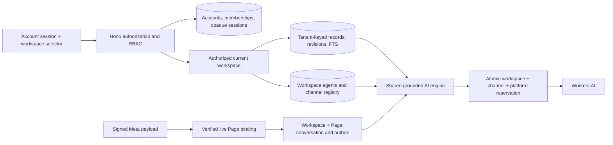

# AI Studio platform architecture — NM-AI-04

AI Studio is the temporary platform name. NẾP MÙI is the preserved first workspace. React/Vite and the existing Hono Worker, D1, Workers AI and GitHub Actions remain the entire infrastructure; no billing system or new paid service was added.

## Workspace resolution and data

`brands` remains the tenant identity table so existing `(brand_id, kind, id)` keys, knowledge versions, FTS contents, usage and conversation history do not move. Migration `0003_platform.sql` removes only the `one_active_brand` index and adds workspace profiles, accounts, memberships, sessions, agent/channel registries, attributed audit, shared quotas and scheduling cursors. NẾP MÙI's implicit persona default is materialized only if it never had a saved persona; existing records/settings remain untouched.

Account sessions store an authorized current workspace in D1. Every request rechecks account status, authentication generation and current membership. Workspace switching authorizes the target on the server. `BRAND_ID` is removed from the deployed configuration; a legacy internal transport parameter is populated only from authenticated workspace resolution or a server-selected registry row. The old NẾP MÙI cookie/key path exists only before the first founder account is claimed.

The UI sends its expected workspace in `X-Workspace-ID`; the server rejects a stale tab's request when another tab switched the shared session. The header is a consistency check, never authorization. Workspace switches reload the application and discard all cached resources, forms and transcripts. API responses remain `no-store`.

Workspaces can be active, inactive or archived. Archived data remains readable to its existing authorized members; writes, inbound admission and AI reservation stop. Only Super Admin can restore an archived/inactive workspace. State-change triggers atomically pause queued/working deliveries and remove queued message copies. Reopening does not replay cancelled jobs. Retention continues across archived workspaces.

## Agents, channels and factual answers

Persona precedence is workspace default → selected reusable agent → channel overrides. Explicit changes to the workspace language update its default persona language in the same versioned batch. Agent and channel lookups always include the authorized workspace. Overrides can change persona/model selection, never raise workspace or platform quotas or disable source validation/handover.

The NM-AI-03 strict reply-plan schema and factual renderer remain shared. Brand labels now come from the selected workspace. Retrieval, published-only knowledge checks, current product facts, duplicate/unknown ID rejection, source revisions and privacy-safe diagnostics are preserved. The original 13 hosted assertions and two multi-turn checks are unchanged; benchmark authentication now supports a scoped account after founder bootstrap.

Each Page has an immutable registry ID and external ID. Transport namespaces include the registry ID, so the same sender/message ID on two Pages cannot collide. Conversations, deduplication and outbox jobs remain tenant-keyed and are additionally isolated by the channel namespace. Human takeover is per conversation/Page. Mock identity uniqueness is per workspace and cannot reserve a live Facebook Page identity. Live identity uniqueness is global per transport; only Super Admin can claim a live binding, and its encrypted token must prove the matching Page identity before signed events can be routed.

Ingress verifies the raw-body app HMAC before consulting Page IDs. Admission atomically checks the current workspace, connected/paused state, mock/live mode and verified binding. Harmless renames/configuration changes do not silently discard events. Send claims additionally recheck source revisions, thread version, Page configuration version and workspace state. Pause/disconnect/archive cancellation happens in the state transaction. Staging hard-blocks real Messenger ingress and sending, including when both flags are injected.

Instagram and website registry types and normalized adapter contracts are present. Public Instagram/widget ingress and OAuth onboarding are not enabled. Page verification is a bounded read-only Graph identity check; it does not activate a transport or send a message.

## Limits and background work

One `INSERT ... SELECT` atomically checks active workspace, workspace limits and shared platform limits. Its trigger updates workspace, channel and platform counters in the same transaction. Existing usage is backfilled into platform usage; counters are never reset for an experiment. A workspace can reserve at most half the configured platform allowance, leaving headroom for other workspaces. The platform Neuron ceiling cannot exceed 8,000/day; Cloudflare's shared account-wide Free allocation remains the final external cap, including any unrelated Workers.

Each two-minute tick processes one workspace retention batch and one eligible Page/legacy mock queue. Durable D1 cursors provide rotation rather than scanning every tenant in one Free-plan invocation. Legacy mock queues continue after account bootstrap. Legacy live jobs remain preserved and inert pending a separately approved Page binding/migration disposition; no pending live work is automatically replayed.

[Workers Web Crypto](https://developers.cloudflare.com/workers/runtime-apis/web-crypto/) · [D1 batch atomicity](https://developers.cloudflare.com/d1/worker-api/d1-database/) · [Workers AI JSON Mode](https://developers.cloudflare.com/workers-ai/features/json-mode/)
