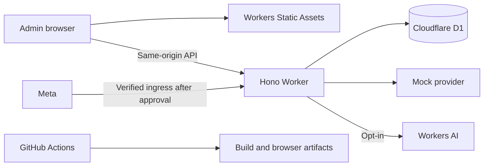

# Architecture

React 19, TypeScript and Vite build the client. Tailwind CSS and a shadcn-style Button built on Radix Slot and CVA provide UI primitives. Navigation copy is keyed with Vietnamese and English equivalents. The interface and forms currently ship in Vietnamese. All fonts and UI assets are served by the Worker.

Hono handles session, CRUD, inference, audit and webhook routes. D1 is accessed through Drizzle for typed scoped CRUD and parameterized D1 statements for atomic SQL operations. The schema uses a typed JSON record per tenant and entity type. Zod validates writes. Composite keys include `brand_id`. One active brand is enforced in the migration. The Worker selects it through `BRAND_ID`, authenticated cookies are bound to it, and the frontend has no brand override.

Knowledge and review updates use compare-and-swap versions. A correction becomes a published knowledge entry in the same D1 batch that advances the correction. Audit SQL triggers record entity versions alongside writes. Conversation audit entries retain status only. Messenger delivery admission and conversation append are atomic. Source retrieval ranks accent-normalized title tokens across up to 200 recent published entries in D1. It passes at most four candidates to a provider that returns a source ID or abstains. The gateway returns source text verbatim. On unknown, sensitive, unavailable, or budget-limited cases, it records handover. Product catalog data remains editorial and does not become a published answer automatically.

The mock and Workers AI providers share a selection contract. Gemini and OpenAI can implement it in the future. The channel adapter contract normalizes inputs, while signed Messenger ingress is the only live route implemented. Instagram and Website adapter contracts accept normalized events for future transport integration.

Cloudflare configuration follows the current programmatic CLI approach. The package lock reproducibly pins the matching Cloudflare CLI and Vite plugin release candidates. The cloud workspace and CI run Miniflare with a disposable D1 instance for tests. The Cloudflare deployment requires a separately provisioned D1 database.

[Cloudflare programmatic configuration](https://developers.cloudflare.com/cf/projects/cloudflare-config/) · [Workers Static Assets](https://developers.cloudflare.com/workers/static-assets/routing/worker-script/) · [D1 Worker API and batch](https://developers.cloudflare.com/d1/worker-api/d1-database/) · [Workers AI pricing](https://developers.cloudflare.com/workers-ai/platform/pricing/)
